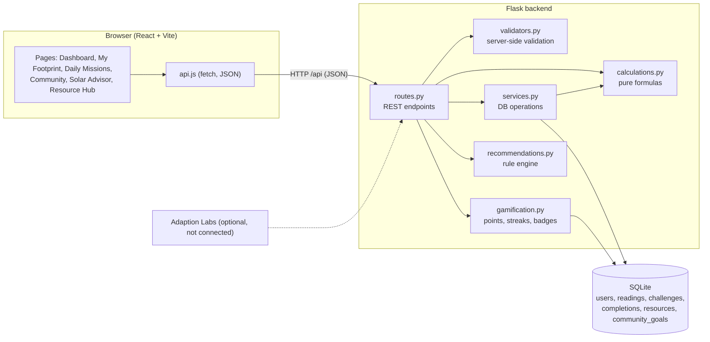

# Architecture

## Diagram



Plain-text version:

```
React (Vite) --HTTP/JSON--> Flask routes --> validators
                                  |--> services --> SQLite
                                  |--> calculations (pure)
                                  |--> gamification (derived from completions)
                                  |--> recommendations (rules)
                 (optional, not connected) Adaption Labs coach
```

## Data model

```
users 1 --- * readings        UNIQUE(user_id, period)
users 1 --- * completions     UNIQUE(user_id, challenge_id, completed_on)
challenges 1 --- * completions
resources, community_goals    reference tables
```

Key constraints (see `backend/wattwise/schema.sql`): positive kWh and tariff, `YYYY-MM` period
format, household 1-50, AC hours 0-24, foreign keys on. The unique constraint on completions is
what prevents duplicate points for the same mission on the same day.

## Design decisions

- **Derived, not duplicated.** Points, streaks, badges, leaderboard and community progress are all
  computed from saved completion and reading rows, so they cannot drift or be faked.
- **Pure calculations.** `calculations.py` has no Flask or database code, so formulas are easy to
  unit test and explain.
- **Emission factor stored per reading.** Changing the configured factor later does not silently
  rewrite history.
- **Dashboard refresh.** Pages share a `version` counter; saving a reading or completing a mission
  bumps it, which re-fetches every visible panel.
- **Secrets stay on the server.** The optional AI credentials are read from environment variables
  and never sent to the frontend.
